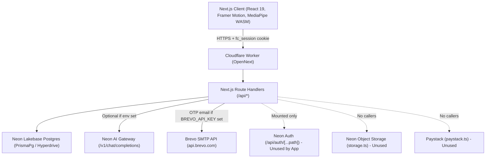
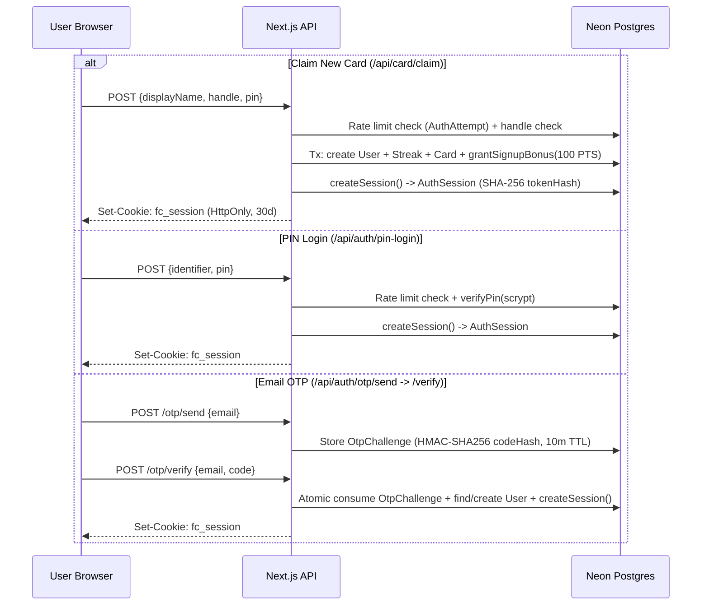
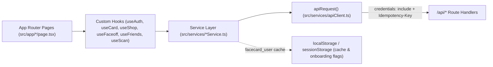

# 01 — Repository & System Architecture

## 1. Repository Classification

Face Card is a **single-package full-stack Next.js 16 application** (monolith) with an accompanying Neon Functions starter (`hello.ts`) and Cloudflare Workers deployment configuration (`wrangler.jsonc`, `open-next.config.ts`). It is **not** a monorepo (no `workspaces` in `package.json`, no `packages/` or `apps/` subdirectories).

---

## 2. Repository Structure

```text
facecard/
├── .github/workflows/ci.yml       # CI: tsc, eslint, vitest, opennextjs-cloudflare build
├── docs/                          # Product & spec docs (PRD, PRODUCT, BACKEND, FRONTEND, AI_RATING, AUDIT, STYLE, PLAN)
├── prisma/
│   ├── schema.prisma              # 16 models, 10 enums (PostgreSQL)
│   ├── seed.ts                    # Seeds 6 ShopItems, 5 Users, Streaks, Card, Scan, Ledger, 3 FaceOffs
│   └── migrations/
│       ├── 0_init/                # Initial schema SQL
│       ├── 1_auth_sessions/       # AuthSession, OtpChallenge, AuthAttempt
│       └── 2_points_integrity/    # Non-negative balance CHECKs + PointsLedger append-only trigger
├── scripts/                       # Ad-hoc DB inspection & constraint scripts (add_constraints.ts, etc.)
├── src/
│   ├── app/
│   │   ├── layout.tsx             # Root layout (ThemeProvider, QueryProvider, ToastProvider, BottomNav)
│   │   ├── globals.css            # Tailwind v4 + CSS custom properties
│   │   ├── api/                   # 27 Next.js Route Handler files
│   │   └── [pages]/               # 21 App Router page files
│   ├── components/
│   │   ├── camera/                # LivenessOverlay.tsx
│   │   ├── card/                  # FaceCard.tsx, ClaimFaceCardModal.tsx, ShareCardModal.tsx, engraving.ts, materials.ts
│   │   ├── commerce/              # Atelier preview-only components (ProductCard, PDP, Bag, Checkout, Routine, Orders)
│   │   ├── common/                # ToastProvider, TopStatsBar, UserAvatar, ThemeToggle, Skeleton, PlayfulBackground
│   │   ├── faceoff/               # DuelDetailModal.tsx
│   │   ├── home/                  # ChallengeDuelCard.tsx, LeaderboardPodium.tsx
│   │   ├── navigation/            # BottomNav.tsx (mobile dock + desktop left sidebar)
│   │   ├── providers/             # QueryProvider.tsx, ThemeProvider.tsx
│   │   └── ui/                    # Button, Input, SurfaceCard, PageHeader, StateViews, MotionPrimitives
│   ├── hooks/                     # Client state hooks (useAuth, useCard, useFaceoff, useFriends, useScan, useShop)
│   ├── lib/
│   │   ├── auth/                  # server.ts (Neon Auth), client.ts, session.ts, sessions.ts, otp.ts, pin.ts, rateLimit.ts
│   │   ├── rating/                # engine.ts (scoreFace), fairness.ts (runFairnessAudit)
│   │   ├── spikes/                # spikes.ts (legacy/spike scoring & Brevo/SVG helpers)
│   │   ├── vision/                # liveness.ts (MediaPipe FaceLandmarker + optical fallback)
│   │   ├── aiGateway.ts           # Unused Neon AI Gateway wrapper
│   │   ├── avatar.ts              # Initials SVG + preset emblems + cover art SVG
│   │   ├── db.ts                  # PrismaClient proxy with Cloudflare Hyperdrive / DATABASE_URL resolution
│   │   ├── economy.ts             # EconomyConfig constants
│   │   ├── faceoff.ts             # Arena duel lifecycle (create, join, resolve, cancel, expire)
│   │   ├── idempotency.ts         # IdempotencyRecord middleware
│   │   ├── ledger.ts              # postLedger(), grantSignupBonus(), reconciliation
│   │   ├── logger.ts              # StructuredLogger with base64/secret scrubber
│   │   ├── paystack.ts            # Unused Paystack API + webhook signature helper
│   │   ├── scoring.ts             # calculateRawScore, getVerdictBand, calculateScanPoints, getLagosDayKey
│   │   ├── share.ts               # Web Share API + clipboard helper
│   │   ├── storage.ts             # Unused S3/Neon Object Storage presigned URL helpers
│   │   ├── tokens.ts              # BRAND_COLORS, TIER_CONFIG, VERDICT_BANDS
│   │   └── utils.ts               # cn, formatPoints, maskCardNumber
│   ├── services/                  # Typed fetch wrappers (apiClient + 6 domain services)
│   └── types/index.ts             # Core shared TypeScript interfaces & union types
├── tests/                         # 18 Vitest test files + helpers/fakeDb.ts
├── hello.ts                       # Neon Functions starter handler (unused by Next.js app)
├── neon.ts                        # @neon/config v1 service declarations (auth, aiGateway, functions, selfies bucket)
├── next.config.ts                 # images.unoptimized: true, serverExternalPackages: ['pg-cloudflare']
├── open-next.config.ts            # defineCloudflareConfig()
├── prisma.config.js               # Prisma 7 datasource + seed config
└── wrangler.jsonc                 # Cloudflare Workers config (HYPERDRIVE, R2 CARDS_BUCKET, ASSETS)
```

---

## 3. Technology Stack & Dependency Usage

| Category | Technology & Version (`package.json`) | Active Usage Status |
|---|---|---|
| **Framework** | `next` `16.4.0`, `react` `19.3.0`, `react-dom` `19.3.0` | **Actively used** (App Router, Route Handlers, `next/og`) |
| **Language** | `typescript` `^5` (`strict: true`) | **Actively used** |
| **Styling** | `tailwindcss` `^4`, `@tailwindcss/turbopack` `^4` | **Actively used** |
| **Animations** | `framer-motion` `^14.1.0` | **Actively used** (`FaceCard`, modals, `BottomNav`, `FramerTabPanel`) |
| **Icons** | `lucide-react` `^1.55.0` | **Actively used** |
| **Data Fetching** | `@tanstack/react-query` `^5.104.2` | **Mounted** in `QueryProvider.tsx`, but hooks use raw `useState`+`useEffect`+`fetch` |
| **Forms & Validation** | `react-hook-form` `^7.90.0`, `@hookform/resolvers` `^5.9.1`, `zod` `^3.25.76` | **Installed, largely unused** in inspected UI/API routes (manual validation used instead) |
| **Database & ORM** | `prisma` `^7.10.0`, `@prisma/client` `^7.10.0`, `@prisma/adapter-pg` `^7.10.0`, `pg` `^8.23.1`, `pg-cloudflare` `^1.4.1` | **Actively used** (`src/lib/db.ts`) |
| **Neon Packages** | `@neondatabase/serverless` `^1.2.0`, `@prisma/adapter-neon` `^7.10.0` | **Used in `prisma/seed.ts`**, not in `src/lib/db.ts` (uses `pg` + `PrismaPg`) |
| **Auth** | `@neondatabase/auth` `^0.6.0-beta` | **Mounted** at `/api/auth/[...path]`, **unused** by app flows (custom `AuthSession` used) |
| **Neon Infra** | `@neon/config` `^1.9.1`, `@neon/env` `^1.6.1` | `neon.ts` config only |
| **Object Storage** | `@aws-sdk/client-s3` `^3.1150.0`, `@aws-sdk/s3-request-presigner` `^3.1150.0` | **Unused** (`src/lib/storage.ts` has no callers) |
| **Computer Vision** | `@mediapipe/tasks-vision` `^1.1.1` | **Actively used** in browser (`src/lib/vision/liveness.ts`) via CDN WASM |
| **Email** | Brevo HTTP API (`fetch`) | **Actively used** in `src/lib/spikes/spikes.ts` (if `BREVO_API_KEY` set; dev fallback returns code) |
| **AI Vision** | Neon AI Gateway (`fetch` to `/v1/chat/completions`) | **Conditionally used** in `src/lib/rating/engine.ts` (falls back to SHA-256 hash) |
| **Payments** | Paystack (`src/lib/paystack.ts`) | **Unused** (no API routes or UI callers) |
| **Hosting** | `@opennextjs/cloudflare` `^1.20.11`, `wrangler` `^4.151.0` | **Configured** (`wrangler.jsonc`, `open-next.config.ts`) |
| **Testing** | `vitest` `^2.1.9`, `tsx` `^4.23.15` | **Configured** (`tests/*.test.ts`) |

---

## 4. Existing System Architecture Diagrams

### 4.1 Overall System Architecture (Verified)



### 4.2 Authentication & Session Lifecycle (Verified)



### 4.3 Frontend Data Flow (Verified)


