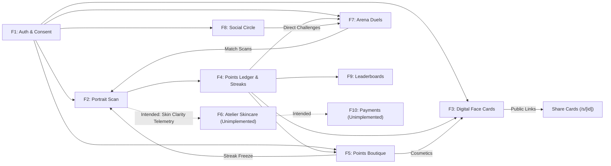

# 04 — Complete Feature Inventory

## 1. Feature Groups & Status

### F1. Identity, Claim & Authentication
- **Purpose:** Frictionless onboarding via Handle + PIN or Email OTP; session management; NDPA consent & account deletion.
- **Routes & Components:** `/`, `/sign-in`, `/verify`, `/onboarding`, `ClaimFaceCardModal.tsx`, `src/lib/auth/*`.
- **Implementation:** Custom `fc_session` opaque cookie stored as SHA-256 hash in `AuthSession` (`src/lib/auth/sessions.ts`). PIN hashed with `scrypt` (`src/lib/auth/pin.ts`). OTP hashed with HMAC-SHA256 (`src/lib/auth/otp.ts`). Rate-limited via `AuthAttempt`.
- **Status:** **Implemented** (with security gaps: `PATCH /api/me` allows unverified email change; `@neondatabase/auth` is mounted at `/api/auth/[...path]` but unused).

### F2. Portrait Scan & AI Rating Pipeline
- **Purpose:** Evaluate selfie photo craft & facial aesthetics (0–100), enforce daily 3-scan cap, update streak & points.
- **Routes & Components:** `/scan`, `LivenessOverlay.tsx`, `src/lib/rating/engine.ts`, `src/lib/vision/liveness.ts`, `src/app/api/scan/route.ts`.
- **Implementation:** Byte-level quality gate (`analyzeImageBytes`), optional Neon AI Gateway (`gpt-4o-mini`) vision call, deterministic SHA-256 fallback scoring, `ScanSlot` concurrency guard, ACID `Scan` + `PointsLedger` + `Streak` update.
- **Status:** **Partially Implemented** (AI Gateway falls back to SHA-256 hash; liveness is client-only and skippable; `boost-aura-2x` is never consumed).

### F3. Digital Face Cards & Tier Progression
- **Purpose:** Render collectible ID-1 proportion cards with 4 material tiers, procedural contour engraving, and shareable story graphics.
- **Routes & Components:** `/card`, `/s/[id]`, `FaceCard.tsx`, `materials.ts`, `engraving.ts`, `ShareCardModal.tsx`, `/api/card`, `/api/share-cards`, `/api/og`.
- **Implementation:** Deterministic FNV-1a + Mulberry32 contour engraving; `User.tier` auto-upgrades on `LIFETIME` points in `postLedger()`; `ShareCard` persisted for 30 days.
- **Status:** **Implemented** (with contradictions: `/api/card` shows 10,000 PTS for Black Card vs 20,000 in `EconomyConfig`; `DELETE /api/share-cards/[id]` lacks auth/ownership).

### F4. Points Economy & Append-Only Ledger
- **Purpose:** Track `LIFETIME` (tier-determining, non-decreasing) and `SPENDABLE` (shop/arena) balances with full auditability.
- **Routes & Components:** `/card` (Ledger tabs), `src/lib/ledger.ts`, `src/lib/economy.ts`, `src/app/api/points/route.ts`, `src/app/api/cron/reconcile/route.ts`.
- **Implementation:** `postLedger()` writes `PointsLedger` before updating `User` balance; DB `CHECK` constraints & `PointsLedger_append_only` trigger (`migration 2_points_integrity`); `IdempotencyRecord` for request-level deduplication.
- **Status:** **Implemented**.

### F5. Points Boutique (`/shop`)
- **Purpose:** Spend `SPENDABLE` points on digital card cosmetics (`SKIN`, `TITLE`, `FRAME`) and consumables (`streak-freeze`, `boost-aura-2x`).
- **Routes & Components:** `/shop`, `/api/shop`, `/api/shop/items`, `/api/shop/purchase`, `/api/shop/equip`.
- **Implementation:** Tier-gated catalog, `maxOwned` & `MAX_STREAK_FREEZES` checks, atomic purchase + equip on `Card`.
- **Status:** **Partially Implemented** (fallback idempotency key blocks 2nd purchase of `streak-freeze`; `boost-aura-2x` has no effect on scans).

### F6. Atelier — Skincare Storefront & Routines (`/skincare`)
- **Purpose:** Curated skincare commerce (Catalogue, PDP, Skin Profile Questionnaire, AM/PM Routines, Shopping Bag, Checkout, Order History).
- **Routes & Components:** `/skincare`, `src/components/commerce/*`.
- **Implementation:** **Frontend-only preview**. All buttons disabled, empty slots, no APIs, no DB tables.
- **Status:** **Frontend-only / Unimplemented**.

### F7. Arena & Face-Off Duels (`/faceoff`)
- **Purpose:** 1v1 staked (5% fee) or friendly portrait duels with 24h expiry, invite codes, and up to 3 attempts.
- **Routes & Components:** `/faceoff`, `/faceoff/[id]`, `/arena/invite/[code]`, `DuelDetailModal.tsx`, `src/lib/faceoff.ts`, `/api/faceoffs/*`.
- **Implementation:** Full DB lifecycle (`WAITING` -> `ACTIVE` -> `TIE_REMATCH` -> `COMPLETED`/`EXPIRED`/`CANCELLED`), stake escrow & payout via `postLedger()`, forfeit/ghost-refund handling in `expireStaleDuels()`.
- **Status:** **Implemented** (minor UI/rule mismatch: `/scan` says `Attempt X/2` instead of `/3`; no real-time push updates).

### F8. Social Circle, Friends & Gifting (`/friends`)
- **Purpose:** Add/remove friends, view contender profiles & H2H records, invite friends, gift points.
- **Routes & Components:** `/friends`, `/friends/add`, `/friends/[id]`, `/u/[id]`, `/api/friends/*`.
- **Implementation:** Friendships stored in `AuditLog` (`action: 'ADD_FRIEND'`). No friend request/accept workflow (instant one-way add).
- **Status:** **Partially Implemented** (Point gifting `handleGiftPoints` is mocked; `/profile` friend removal is local-only; `FC-8821-ATELIER` referral bonus is hardcoded/unimplemented).

### F9. Leaderboards (`/leaderboard`)
- **Purpose:** Rank top contenders by lifetime points.
- **Routes & Components:** `/leaderboard`, `LeaderboardPodium.tsx`, `/api/leaderboard`.
- **Implementation:** Queries top 50 users by `lifetimePoints desc`.
- **Status:** **Partially Implemented** (`Circle` and `This Week` tabs do not filter or re-query; `DELETED`/`BANNED` users are not excluded).

### F10. Fiat Payments (`src/lib/paystack.ts`)
- **Purpose:** Paystack transaction initialization & webhook verification for cosmetics, practice scans, and memberships.
- **Implementation:** Library functions only; **no API routes or UI**.
- **Status:** **Documented / Stubbed only**.

### F11. Object Storage (`src/lib/storage.ts`)
- **Purpose:** S3-compatible presigned upload/download/delete for `selfies` / `assets` bucket.
- **Implementation:** Library functions only; **zero callers**.
- **Status:** **Stubbed / Unused**.

### F12. Operations, Fairness & Health
- **Purpose:** Healthcheck (`/api/health`), Ledger & Duel reconciliation cron (`/api/cron/reconcile`), Monk Skin Tone fairness harness (`/api/rating/fairness`).
- **Status:** **Implemented** (though `runFairnessAudit()` runs on synthetic default inputs without real skin-tone image cohorts).

---

## 2. Feature Dependency Graph

