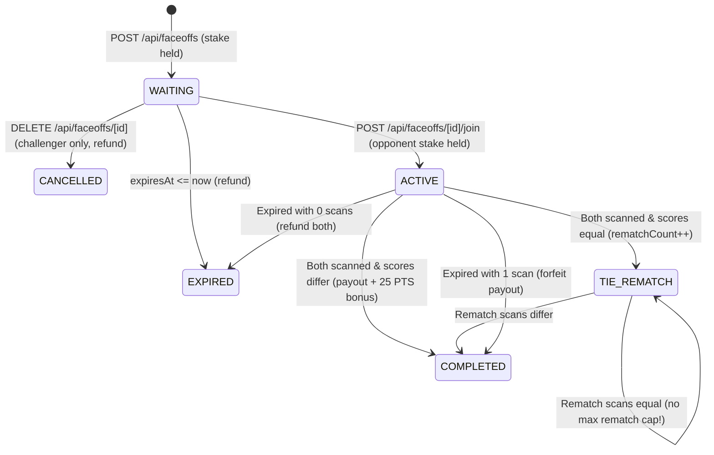

# 10 — Arena & Competitive Functionality (Face-Offs)

## 1. Arena Rules & Lifecycle (`src/lib/faceoff.ts`, `src/app/api/faceoffs/*`, `src/app/api/scan/route.ts`)

- **Modes:** `STAKED` (allowed stakes: `50, 100, 250, 500` PTS from `EconomyConfig.ARENA.STAKE_OPTIONS`) and `FRIENDLY` (`stake = 0`).
- **Daily Cap:** `MAX_DUELS_PER_DAY = 5` (checked in `getDailyDuelCount` at creation and join, resetting `00:00` `Africa/Lagos`).
- **Matchmaking Rules:**
  - **Same-Tier Parity:** Enforced on `createFaceOff` when `mode === 'STAKED'` (`faceoff.ts:87`), and **always** enforced on `joinFaceOff` (`faceoff.ts:170`, even for `FRIENDLY` duels — slight asymmetry with `createFaceOff`!).
  - **Direct vs. Open:** Optional `opponentHandle` restricts `joinFaceOff` to that user (`403` otherwise).
  - **Expiry:** `24 hours` (`EXPIRY_MINUTES = 1440`).
- **Attempts & Resolution:**
  - Each contender gets `ATTEMPTS_PER_DUEL = 3` (`EconomyConfig.ARENA.ATTEMPTS_PER_DUEL`) per round (`3 * (rematchCount + 1)`). *(Note: `scan/page.tsx:594` erroneously displays `Attempt X/2`.)*
  - First scan by both contenders triggers `resolveFaceOff(duelId)` immediately inside `POST /api/scan` (`scan/route.ts:226-232`).
  - **Contradiction / Subtlety:** Because `resolveFaceOff()` runs as soon as **both** contenders have `>= 1` scan, the second player to scan cannot use their 2nd or 3rd attempt unless the first player hasn't scanned yet or a tie occurred!
  - **Payout:** Winner receives `totalPot - Math.round(totalPot * 0.05)` (5% system fee recorded as `FACEOFF_FEE` in `PointsLedger` — note `PointsLedger` writes `userId: winnerId` with positive `amount: systemFee` without updating `User` balance, just as an audit record) + `WIN_BONUS_POINTS = 25`.
  - **Ties:** Transitions to `TIE_REMATCH` (`rematchCount += 1`, stakes remain held). Next scan overwrites `challengerBestScanId` / `opponentBestScanId` even if lower (`isRematch || score > currentBestScore`).
- **Expiry & Forfeits (`expireStaleDuels`, `faceoff.ts:403-568`):**
  - `WAITING` expired -> `EXPIRED`, refund challenger stake.
  - `ACTIVE` / `TIE_REMATCH` expired: if only one scanned -> that player wins by forfeit (payout without 25 PTS win bonus); if both scanned -> `resolveFaceOff`; if neither scanned -> `EXPIRED`, refund both.
  - Triggered on `GET /api/faceoffs` and `GET /api/cron/reconcile`.

## 2. FaceOff State Diagram

## 3. Unresolved Gaps & Abuse Risks
- **Infinite Tie Rematches:** No maximum `rematchCount` cap (docs `AUDIT.md` B3 specified 1 rematch then refund, code allows infinite rematches).
- **No Real-Time Updates:** Polling/manual refresh only; no WebSockets or SSE.
- **No Reporting/Moderation:** No UI or API to report Arena opponents or disputed matches.
- **2nd-Player Attempt Lockout:** `resolveFaceOff()` fires immediately on the 2nd player's 1st scan, preventing them from taking attempts 2 & 3.
