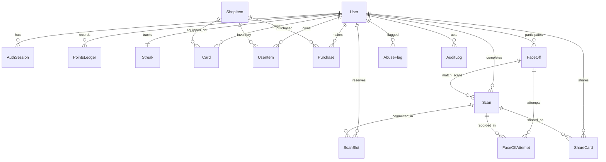

# 12 — Existing Database Schema & Persistence

## 1. Database Engine & Configuration

- **Engine:** PostgreSQL (Neon Lakebase Postgres) accessed via `PrismaPg` (`pg.Pool`, `max: 10`) in `src/lib/db.ts`, with Cloudflare `HYPERDRIVE` binding fallback.
- **Schema File:** `prisma/schema.prisma` (16 models, 10 enums).
- **Migrations:**
  - `prisma/migrations/0_init/migration.sql` (initial 13 models + enums)
  - `prisma/migrations/1_auth_sessions/migration.sql` (`AuthSession`, `OtpChallenge`, `AuthAttempt`)
  - `prisma/migrations/2_points_integrity/migration.sql` (`User_spendableBalance_nonneg`, `User_lifetimePoints_nonneg` CHECK constraints + `PointsLedger_append_only` trigger)
- **Schema Drift Detected:**
  - `User.avatarUrl` (`prisma/schema.prisma:97`) is **missing** from `0_init/migration.sql` (was likely applied via `prisma db push`).
  - `scripts/add_constraints.ts` defines additional `CHECK` constraints (`check_streak_current_count_non_negative`, `check_shop_item_price_non_negative`) and enables RLS on 9 tables with permissive `USING (true) WITH CHECK (true)` policies — **not** in `prisma/migrations/`.

---

## 2. Existing Tables Summary (`prisma/schema.prisma`)

| Table | PK | Key Columns & Constraints | Relations | Soft Delete |
|---|---|---|---|---|
| `User` | `id` (UUID) | `email? @unique`, `displayName`, `handle? @unique`, `ageConfirmedAt?`, `consentVersion?`, `consentAt?`, `lifetimePoints` (0), `spendableBalance` (0), `tier` (`CLASSIC`), `status` (`ACTIVE`), `pinHash?`, `avatarUrl?`, `unlockedAt?`, `invitedByFaceOffId?` | 1:N `Scan`, `ScanSlot`, `PointsLedger`, `Card`, `UserItem`, `Purchase`, `FaceOff`, `ShareCard`, `AbuseFlag`, `AuditLog`, `AuthSession`; 1:1 `Streak` | `status = DELETED` (tombstone) |
| `AuthSession` | `id` (UUID) | `userId` (FK Cascade), `tokenHash @unique`, `expiresAt`, `revokedAt?`, `ip?`, `userAgent?` | `User` | `revokedAt` |
| `OtpChallenge` | `id` (UUID) | `email`, `codeHash`, `attempts` (0), `expiresAt`, `consumedAt?` | None | `consumedAt` |
| `AuthAttempt` | `id` (UUID) | `kind`, `key`, `createdAt` | None | No |
| `ScanSlot` | `id` (UUID) | `userId` (FK Cascade), `dayKey`, `slotIndex` (1..3), `state` (`RESERVED`/`COMMITTED`/`RELEASED`), `scanId?`, `expiresAt`; `@@unique([userId, dayKey, slotIndex])` | `User`, `Scan?` | No |
| `Scan` | `id` (UUID) | `userId` (FK Cascade), `score` (0-100), `band`, `categoryScores` (Json), `modelVersion`, `promptVersion`, `scanIndexOfDay`, `dayKey`, `source` (`SOLO`/`FACEOFF`/`PRACTICE`), `faceOffId?` | `User`, `FaceOff?`, `FaceOffAttempt[]`, `ScanSlot[]`, `ShareCard[]` | No |
| `PointsLedger` | `id` (UUID) | `userId` (FK **Restrict**), `type` (`LedgerType`), `amount`, `balanceKind` (`LIFETIME`/`SPENDABLE`), `refType?`, `refId?`, `idempotencyKey`; `@@unique([idempotencyKey, balanceKind])` | `User` | **Append-only** (DB trigger blocks UPDATE/DELETE) |
| `Streak` | `id` (UUID) | `userId @unique` (FK Cascade), `currentCount` (1), `longestCount` (1), `lastScanDayKey`, `freezesHeld` (0) | `User` | No |
| `Card` | `id` (UUID) | `userId` (FK Cascade), `cardNumber @unique`, `equippedSkinId?`, `equippedTitleId?`, `equippedFrameId?`, `slot` (1) | `User`, `ShopItem?` (skin, title, frame) | No |
| `ShopItem` | `id` (UUID) | `slug @unique`, `kind` (`ItemKind`), `name`, `description?`, `price`, `minTier`, `maxOwned` (1), `active` (true), `assetRef?` | `UserItem[]`, `Purchase[]`, `Card[]` | `active = false` |
| `UserItem` | `id` (UUID) | `userId` (FK Cascade), `itemId` (FK Restrict), `quantity` (1); `@@unique([userId, itemId])` | `User`, `ShopItem` | No |
| `Purchase` | `id` (UUID) | `userId` (FK Cascade), `itemId` (FK Restrict), `price`, `idempotencyKey @unique` | `User`, `ShopItem` | No |
| `FaceOff` | `id` (UUID) | `challengerId` (Restrict), `opponentId?` (Restrict), `inviteCode @unique`, `mode`, `stake`, `status`, `challengerBestScanId?`, `opponentBestScanId?`, `winnerId?`, `rematchCount`, `feeAmount`, `expiresAt`, `resolvedAt?` | `User` (×3), `Scan` (×3), `FaceOffAttempt[]`, `ShareCard[]` | `CANCELLED`/`EXPIRED` |
| `FaceOffAttempt` | `id` (UUID) | `faceOffId` (Cascade), `userId` (Cascade), `scanId` (Cascade), `attemptNumber` (1..3) | `FaceOff`, `User`, `Scan` | No |
| `ShareCard` | `id` (UUID) | `userId` (Cascade), `publicId @unique`, `scanId?`, `faceOffId?`, `blobKey`, `expiresAt`, `deletedAt?` | `User`, `Scan?`, `FaceOff?` | `deletedAt` (unused) |
| `IdempotencyRecord` | `id` (UUID) | `key @unique`, `userId?`, `route`, `requestHash`, `status`, `responseBody` (Json), `expiresAt` | None | No |
| `EconomyConfig` | `version` (Int PK) | `values` (Json), `activeFrom` | None | No (**Unused**; code uses `src/lib/economy.ts`) |
| `AbuseFlag` | `id` (UUID) | `userId` (Cascade), `reason`, `severity`, `reviewedAt?`, `outcome?` | `User` | No (**Unused** in app routes) |
| `AuditLog` | `id` (UUID) | `actorId?`, `action`, `targetType`, `targetId?`, `detail` (Json?) | `User?` | No (Abused for `ADD_FRIEND`!) |

---

## 3. Existing Database ER Diagram (Verified Entities Only)

---

## 4. Persistence Gap Analysis

- **`localStorage`:** `facecard_user` (cached user JSON), `fc_onboarded`, `facecard_handle`, `facecard-theme` (`src/services/authService.ts`, `src/app/onboarding/page.tsx`, `src/app/scan/page.tsx`, `ThemeProvider.tsx`).
- **`sessionStorage`:** `fc_auth_email` (`sign-in/page.tsx`, `verify/page.tsx`).
- **Component-only state needing DB persistence:**
  - Atelier skin goals (`selectedGoals`), shopping bag, checkout address, routines (`src/app/skincare/page.tsx`).
  - Profile `bio`, `location`, `dob` (`src/app/profile/page.tsx`).
  - `isLiked` on `/home` (`src/app/home/page.tsx:33`).
  - `removedFriendIds` on `/profile` (`src/app/profile/page.tsx:212`).
