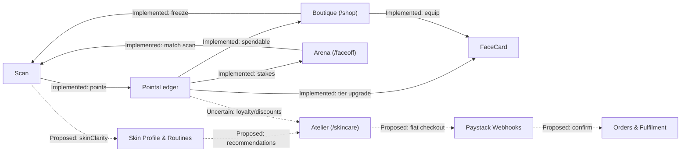

# 20 — Backend Gap Analysis & Coverage Matrix

## 1. Frontend-to-Backend Coverage Matrix

*(Methodology: Qualitative classification per feature based on direct inspection of UI, API routes, Prisma schema, and business logic.)*

| Feature | Route(s) | UI Status | API Status | DB Status | Business Logic | Security | Overall Status |
|---|---|---|---|---|---|---|---|
| Claim Card & PIN Auth | `/`, `/sign-in` | Complete | Complete | Complete | Complete | Good (rate-limited) | **Complete** |
| Email OTP Auth & Link | `/sign-in`, `/verify` | Complete | Complete | Complete | Complete | Good | **Complete** |
| Profile Management | `/profile` | Partial | Partial (`PATCH /api/me` unsafe email) | Partial (no `bio`/`location`/`dob`) | Partial | **P0** (unverified email) | **Partially implemented** |
| Portrait Scan & Scoring | `/scan` | Complete | Complete | Complete | Partial (SHA-256 fallback; no `boost-aura-2x`) | **P1** (skippable liveness) | **Partially implemented** |
| Digital Face Cards | `/card`, `/home` | Complete | Complete | Complete | Partial (10k vs 20k Black threshold) | Good | **Partially implemented** |
| Share Cards & OG | `/s/[id]`, `/card` | Complete | Partial (`DELETE` unauth) | Complete | Partial (expiry ignored) | **P0** (unauth DELETE) | **Partially implemented** |
| Points Ledger & Streaks | `/card` | Complete | Complete | Complete | Complete | Good | **Complete** |
| Points Boutique | `/shop` | Complete | Complete | Complete | Partial (`streak-freeze` 2nd buy blocked; `boost-aura-2x` unused) | Good | **Partially implemented** |
| **Atelier (Skincare)** | `/skincare` | Preview-only | **Missing** | **Missing** | **Missing** | **Missing** | **Missing** |
| **Checkout & Paystack** | `/skincare` | Preview-only | **Missing** (`paystack.ts` stub) | **Missing** | **Missing** | **P1** (webhook dev bypass) | **Missing** |
| Arena Face-Offs | `/faceoff`, `/faceoff/[id]` | Complete | Complete | Complete | Partial (2nd player locked after 1st scan) | Good | **Partially implemented** |
| Social Circle & Friends | `/friends`, `/friends/add`, `/friends/[id]` | Partial | Partial (`AuditLog` abuse; gifting mocked) | Partial (no `Friendship` table) | Partial (referrals unimplemented) | Good | **Partially implemented** |
| Leaderboards | `/leaderboard` | Partial (tabs dead) | Partial (no `ACTIVE` filter) | Complete | Partial | **P2** (`DELETED` users shown) | **Partially implemented** |
| Admin & Moderation | None | **Missing** | **Missing** | Partial (`AbuseFlag` unused) | **Missing** | **Missing** | **Missing** |

---

## 2. Missing Backend Capability Catalogue (Prioritised)

| Gap ID | Domain | Description | Priority |
|---|---|---|---|
| `GAP-SEC-01` | Security | Add auth + ownership check to `DELETE /api/share-cards/[id]` and `GET /api/scans/[id]` | **P0** |
| `GAP-SEC-02` | Security | Remove `email` mutation from `PATCH /api/me` (enforce `/api/auth/link-email` OTP) | **P0** |
| `GAP-SEC-03` | Security | Clear `User.avatarUrl` on `DELETE /api/me` & enforce `status: 'ACTIVE'` on `/api/leaderboard` & `/api/friends` | **P0** |
| `GAP-ATELIER-01` | Atelier Catalogue | Product, Brand, Variant, Category, Ingredient, and Media APIs & DB tables | **P1** |
| `GAP-ATELIER-02` | Atelier Inventory | Stock tracking, atomic reservation with TTL, and release on abandonment | **P1** |
| `GAP-ATELIER-03` | Atelier Cart & Checkout | Persistent Shopping Bag, Shipping Address, Tax/Shipping calc, Order creation | **P1** |
| `GAP-PAY-01` | Payments | Wire `src/lib/paystack.ts` to Checkout API + `/api/webhooks/paystack` (fail-closed signature) | **P1** |
| `GAP-SKIN-01` | Skincare Intelligence | Persist Skin Profile (goals, skin type, allergies) + Consent; link `skinClarity` to Routine Builder | **P1** |
| `GAP-SCAN-01` | Facial Analysis | Enforce server-side face detection + `boost-aura-2x` consumption + fix `10k` vs `20k` Black Card threshold | **P1** |
| `GAP-SHOP-01` | Points Boutique | Fix `POST /api/shop/purchase` fallback idempotency key so 2nd `streak-freeze` can be bought | **P1** |
| `GAP-SOC-01` | Social | Dedicated `Friendship` table, wire `/profile` friend removal, implement or remove Point Gifting & Referrals | **P2** |
| `GAP-LB-01` | Leaderboards | Implement `Circle` (friends) and `This Week` (weekly scan/points) filters + personal rank outside top 50 | **P2** |
| `GAP-ADMIN-01` | Administration | RBAC (`UserRole`), `AbuseFlag` review, Atelier catalog/order/refund management | **P2** |
| `GAP-OPS-01` | Operations | Cloudflare Cron Trigger for `/api/cron/reconcile`, R2 avatar/share-card storage, transactional email | **P2** |

---

## 3. Cross-Domain Dependency Graph (Implemented vs. Proposed)

